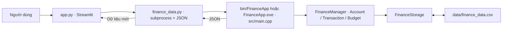
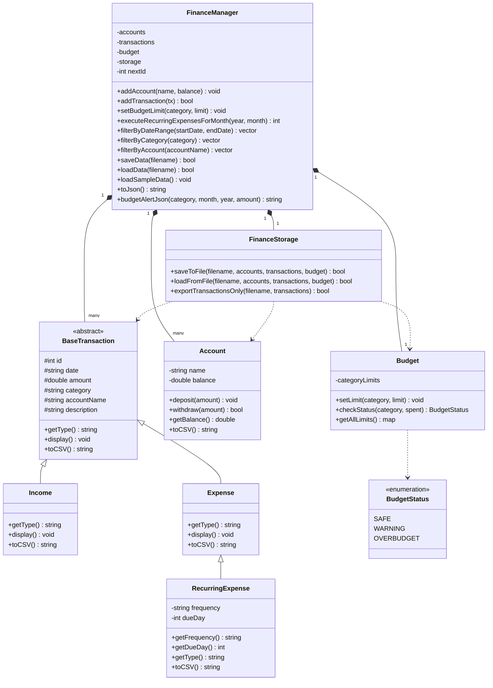

# Hệ thống quản lý tài chính cá nhân

Ứng dụng có giao diện **Streamlit** và phần xử lý nghiệp vụ viết bằng **C++17**. Giao diện gọi chương trình C++ qua `finance_data.py`, nhận kết quả JSON và hiển thị số dư, giao dịch, ngân sách, lịch định kỳ và biểu đồ. Dữ liệu được lưu trong `data/finance_data.csv`.

## Chạy ứng dụng

Yêu cầu chung: trình biên dịch C++17, Python 3.9+ và `pip`. Chạy các lệnh sau **từ thư mục gốc của project**.

**Windows** (cần `g++`, ví dụ MinGW/MSYS2):

```powershell
.\build.bat
python -m pip install -r requirements.txt
python -m streamlit run app.py
```

**macOS** (cần Xcode Command Line Tools để có trình biên dịch `c++`):

```bash
bash build.sh
python3 -m pip install -r requirements.txt
python3 -m streamlit run app.py
```

`build.bat` tạo `bin/FinanceApp.exe` và `bin/test_finance.exe` trên Windows; `build.sh` tạo `bin/FinanceApp` và `bin/test_finance` trên macOS. Có thể chọn trình biên dịch khác bằng `CXX`, ví dụ `CXX=clang++ bash build.sh`. Nếu chưa có backend, giao diện sẽ báo lỗi và yêu cầu biên dịch. Ứng dụng đọc `data/finance_data.csv` đang có; nó **không tự nạp lại dữ liệu mẫu** khi khởi động. Nếu muốn bắt đầu với dữ liệu demo, vào **Cài đặt → Nạp dữ liệu mẫu**. Thao tác này thay thế dữ liệu hiện tại.

Trên Windows, backend nhận tham số tiếng Việt ở dạng UTF-8. Nếu CSV cũ chứa byte ANSI, backend chuyển chúng sang UTF-8 trong bộ nhớ khi đọc; lệnh `get-data` không ghi đè CSV. Lần lưu dữ liệu kế tiếp sẽ ghi lại CSV bằng UTF-8. Những ký tự đã bị Windows thay bằng dấu `?` trước đó không thể tự khôi phục.

Các file thực thi trong `bin/` bị bỏ qua trong Git, nên **máy mới clone repo phải chạy script build của hệ điều hành** trước khi mở Streamlit. Nếu build lỗi, kiểm tra `g++ --version` trên Windows hoặc `c++ --version` trên macOS.

Có thể kiểm tra backend trực tiếp (lệnh chỉ đọc):

```powershell
.\bin\FinanceApp.exe get-data
```

Trên macOS dùng `./bin/FinanceApp get-data`.

## Workflow của project



1. `app.py` tải dữ liệu bằng `get-data` và giữ bản hiển thị trong `st.session_state`. Nút **Làm mới dữ liệu** đọc lại CSV qua backend.
2. Khi người dùng thêm tài khoản, giao dịch hoặc hạn mức, `finance_data.py` gọi `FinanceApp.exe` trên Windows hoặc `FinanceApp` trên macOS bằng `subprocess`.
3. Các lệnh C++ tạo `FinanceManager`, xử lý yêu cầu rồi trả JSON. Phần lớn lệnh đọc CSV đang dùng; riêng `load-sample` đọc `data/finance_data_fixed.csv` rồi ghi dữ liệu demo vào `data/finance_data.csv`. `get-data` chỉ đọc.
4. Giao diện cập nhật session state từ JSON mới. Các màn hình tìm kiếm, bảng thống kê và biểu đồ Streamlit dùng dữ liệu này; C++ vẫn có các hàm lọc và biểu đồ ASCII riêng, nhưng giao diện web không gọi trực tiếp các hàm đó.

## Vị trí hiện thực 7 yêu cầu

| # | Yêu cầu trong đề | Hiện thực | Vị trí trong project |
| --- | --- | --- | --- |
| 1 | Transaction Types (`Income`, `Expense`, `RecurringExpense`) | `BaseTransaction` là lớp trừu tượng; các lớp con xác định loại và cách xuất CSV. | [`include/Transaction.h`](include/Transaction.h) (khai báo lớp), [`src/Transaction.cpp`](src/Transaction.cpp) (hiện thực), [`src/FinanceManager.cpp`](src/FinanceManager.cpp) (`addTransaction`). |
| 2 | Multi-Account Balances (Cash, Bank, E-Wallet) | `Account` giữ số dư từng tài khoản; `deposit` và `withdraw` cộng/trừ tiền. | [`include/Account.h`](include/Account.h), [`src/Account.cpp`](src/Account.cpp), [`src/FinanceManager.cpp`](src/FinanceManager.cpp) (`addAccount`, `findAccount`, `getTotalBalance`). |
| 3 | Category Budget Limits & Over-budget Alerts | `Budget` giữ hạn mức, kiểm tra ngưỡng 80% và vượt 100%; backend trả cảnh báo khi thêm khoản chi. | [`include/Budget.h`](include/Budget.h), [`src/Budget.cpp`](src/Budget.cpp) (`checkStatus`), [`src/FinanceManager.cpp`](src/FinanceManager.cpp) (`budgetAlertJson`), [`src/main.cpp`](src/main.cpp) (`add-transaction`). |
| 4 | Recurring Transaction Scheduler Simulation | Tính tổng chi phí cố định hàng tháng, mô phỏng kỳ mới; CLI hỗ trợ xem trước và ghi nhận. | [`src/FinanceManager.cpp`](src/FinanceManager.cpp) (`calculateMonthlyFixedExpenses`, `executeRecurringExpensesForMonth`), [`src/main.cpp`](src/main.cpp) (`preview-recurring`, `simulate-recurring`), [`app.py`](app.py) (màn hình Chi phí định kỳ). |
| 5 | Filtering & Searching (Date Range, Category, Account) | `FinanceManager` có các hàm truy vấn; giao diện Streamlit lọc dữ liệu JSON để hiển thị. | [`include/FinanceManager.h`](include/FinanceManager.h), [`src/FinanceManager.cpp`](src/FinanceManager.cpp) (`filterByDateRange`, `filterByCategory`, `filterByAccount`), [`app.py`](app.py) (Lịch sử và Tìm kiếm). |
| 6 | ASCII Chart Visualization | C++ dựng biểu đồ cột ASCII cho chi tiêu theo tháng và danh mục. | [`src/FinanceManager.cpp`](src/FinanceManager.cpp) (`renderMonthlySpendingChart`, `renderCategorySpendingChart`); [`tests/test_finance.cpp`](tests/test_finance.cpp) kiểm tra biểu đồ. Giao diện web dùng Plotly trong [`app.py`](app.py). |
| 7 | CSV Export & Data Load | `FinanceStorage` đọc/ghi ba phần tài khoản, ngân sách, giao dịch và xuất danh sách giao dịch. | [`include/FinanceStorage.h`](include/FinanceStorage.h), [`src/FinanceStorage.cpp`](src/FinanceStorage.cpp) (`saveToFile`, `loadFromFile`, `exportTransactionsOnly`), [`src/FinanceManager.cpp`](src/FinanceManager.cpp) (`saveData`, `loadData`), [`finance_data.py`](finance_data.py) (kiểm tra và nhập CSV trên web). |

### Sơ đồ lớp C++ (UML)



### Các chức năng trên giao diện

| Màn hình | Luồng sử dụng |
| --- | --- |
| **Tổng quan** | Xem số dư, thu chi, giao dịch gần đây và đi tới màn hình thêm giao dịch. |
| **Thêm giao dịch** | Chọn `Income`, `Expense` hoặc `RecurringExpense`; backend cộng/trừ số dư, từ chối khoản chi nếu tài khoản không đủ tiền và trả cảnh báo ngân sách khi chạm 80% hoặc vượt hạn mức. |
| **Lịch sử giao dịch** | Lọc theo loại, danh mục, tài khoản; tải CSV của bảng đang lọc. |
| **Tài khoản** | Xem số dư và tạo tài khoản mới. |
| **Ngân sách** | Xem mức chi theo danh mục và đặt hạn mức. |
| **Chi phí định kỳ** | Chọn tháng/năm, xem trước giao dịch và số dư dự kiến, sau đó xác nhận để ghi nhận. |
| **Tìm kiếm** | Tìm giao dịch theo khoảng ngày, danh mục hoặc tài khoản. |
| **Biểu đồ** | Xem biểu đồ chi tiêu theo tháng và danh mục bằng Plotly. |
| **Cài đặt** | Tải CSV đầy đủ, nhập CSV hoặc nạp dữ liệu mẫu. |

### Luồng chi phí định kỳ

- Giao dịch định kỳ gốc được thêm ở màn hình **Thêm giao dịch**. Giao diện nhận tần suất `Monthly`, `Weekly`, `Yearly`, nhưng mô phỏng theo tháng hiện **chỉ áp dụng `Monthly`**.
- **Xem trước** gọi `preview-recurring`: C++ tính trong bộ nhớ và trả các giao dịch/số dư dự kiến, không ghi CSV.
- **Ghi nhận vào dữ liệu** gọi `simulate-recurring` sau khi người dùng xác nhận. Giao diện đọc lại dữ liệu trước khi ghi; nếu CSV đã thay đổi kể từ lúc xem trước, người dùng phải xem trước lại.
- Mô phỏng chỉ tạo kỳ sau tháng bắt đầu, không tạo trùng khoản đã áp dụng, điều chỉnh ngày đến hạn 29–31 về ngày cuối tháng nếu cần và bỏ qua khoản không đủ số dư. Giao dịch tự tạo có tiền tố `[Tu dong]` trong mô tả.

## Dữ liệu và nhập/xuất

`data/finance_data.csv` gồm ba phần theo thứ tự:

```text
#ACCOUNTS
Name,Balance
...
#BUDGETS
Category,Limit
...
#TRANSACTIONS
Type,Id,Date,Amount,Category,Account,Description,Frequency,DueDay
...
```

Số dư trong CSV là **số dư hiện tại**; khi tải file, backend không phát lại toàn bộ lịch sử giao dịch để tính số dư. Mỗi lần ghi giao dịch mới, `FinanceManager` cập nhật số dư rồi `FinanceStorage` ghi lại cả ba phần.

- **Tải dữ liệu hiện tại** ở Cài đặt xuất đủ tài khoản, ngân sách và giao dịch theo định dạng trên. CSV ở **Lịch sử giao dịch** chỉ chứa bảng đã lọc, không dùng để nhập lại toàn bộ dữ liệu.
- **Nạp CSV** ở Cài đặt kiểm tra định dạng, ngày, số tiền, ID và tài khoản tham chiếu; sau khi xác nhận, ứng dụng tạo bản sao `data/finance_data.backup-*.csv`, thay file hiện tại rồi kiểm tra backend đọc được. Nếu bước kiểm tra thất bại, ứng dụng khôi phục dữ liệu cũ.
- **Nạp dữ liệu mẫu** gọi `load-sample`: đọc `data/finance_data_fixed.csv` và ghi đè `data/finance_data.csv`. Nếu thiếu file mẫu hoặc không thể lưu, backend báo lỗi. Nên tải bản CSV hiện tại trước nếu cần giữ dữ liệu.
- Bộ đọc/ghi CSV dùng dấu phẩy làm ký tự phân cách, chưa hỗ trợ dấu phẩy bên trong tên, danh mục hoặc ghi chú.

## Cây thư mục project

```text
ProjectNhi/
├── .streamlit/
│   └── config.toml                  # Màu sắc và font mặc định của Streamlit
├── include/                         # Khai báo lớp và hàm C++
│   ├── Account.h                    # Giao diện tài khoản: số dư, nạp và rút tiền
│   ├── Budget.h                     # Giao diện hạn mức và trạng thái cảnh báo
│   ├── Common.h                     # Hàm dùng chung: tiền tệ, chuỗi và ngày
│   ├── FinanceManager.h             # Giao diện điều phối nghiệp vụ tài chính
│   ├── FinanceStorage.h             # Giao diện đọc, ghi và xuất CSV
│   └── Transaction.h                # Các lớp giao dịch thu, chi và định kỳ
├── src/                             # Hiện thực các lớp C++ và CLI
│   ├── Account.cpp                  # Cập nhật số dư và xuất tài khoản ra CSV
│   ├── Budget.cpp                   # Lưu hạn mức, tính mức cảnh báo
│   ├── FinanceManager.cpp           # Xử lý giao dịch, ngân sách, định kỳ, lọc và JSON
│   ├── FinanceStorage.cpp           # Đọc/ghi tài khoản, ngân sách, giao dịch trong CSV
│   ├── Transaction.cpp              # Hiện thực các loại giao dịch và định dạng CSV
│   └── main.cpp                     # Nhận lệnh CLI, gọi manager, trả JSON
├── tests/                           # Kiểm thử tự động
│   ├── test_finance.cpp             # Kiểm tra 7 nhóm chức năng C++
│   ├── test_finance_bridge.py       # Kiểm tra lỗi và JSON khi Python gọi C++
│   ├── test_finance_import.py       # Kiểm tra nhập CSV, sao lưu và khôi phục
│   ├── test_recurring_preview.py    # Kiểm tra xem trước và ghi nhận định kỳ
│   └── test_sample_data.py          # Kiểm tra khôi phục demo từ CSV mẫu
├── data/                            # Dữ liệu CSV
│   ├── finance_data.csv             # File dữ liệu mặc định của ứng dụng
│   └── finance_data_fixed.csv       # Nguồn dữ liệu demo cho lệnh load-sample
├── bin/                             # Kết quả biên dịch, không lưu trong Git
│   ├── FinanceApp(.exe)             # Backend CLI, có .exe trên Windows
│   └── test_finance(.exe)           # Chương trình kiểm thử C++
├── design/
│   └── remaining-screens-preview.html # Bản xem trước giao diện bằng HTML
├── app.py                           # Trang Streamlit và các thao tác người dùng
├── finance_data.py                  # Gọi C++ qua subprocess; kiểm tra/nhập CSV
├── style.css                        # Kiểu hiển thị cho giao diện Streamlit
├── requirements.txt                 # Thư viện Python: Streamlit, pandas, Plotly
├── build.bat                        # Biên dịch ứng dụng và bộ kiểm thử C++
├── build.sh                         # Biên dịch ứng dụng và bộ kiểm thử trên macOS
├── run_test.bat                     # Biên dịch lại và chạy kiểm thử C++
├── .gitignore                       # Loại file build, dữ liệu test, file IDE khỏi Git
├── AGENTS.md                        # Quy tắc làm việc và chỉnh sửa project
├── Git.md                           # Hướng dẫn phối hợp nhóm và dùng Git
├── LICENSE                          # Điều khoản cấp phép của project
└── README.md                        # Tổng quan, cách chạy và workflow
```

`BaseTransaction` là lớp trừu tượng; `Income` và `Expense` kế thừa từ đó, còn `RecurringExpense` kế thừa từ `Expense`. `FinanceManager` quản lý các tài khoản, giao dịch và ngân sách; `FinanceStorage` đọc/ghi CSV.

## Chạy các test

Chạy từ thư mục gốc của project. Biên dịch trước để các test tích hợp Python có thể gọi backend:

```powershell
.\build.bat
.\run_test.bat
python -m unittest discover -s tests -p "test_*.py" -v
```

Trên macOS:

```bash
bash build.sh
./bin/test_finance
python3 -m unittest discover -s tests -p 'test_*.py' -v
```

- `run_test.bat` biên dịch lại `bin/test_finance.exe` và chạy `tests/test_finance.cpp`: 7 nhóm kiểm tra giao dịch, tài khoản, ngân sách, định kỳ, lọc, biểu đồ ASCII và lưu/đọc CSV.
- `unittest discover` chạy `tests/test_finance_bridge.py` (tên backend theo hệ điều hành, JSON và trường hợp không có `stdout`), `tests/test_finance_import.py` (định dạng CSV, sao lưu/khôi phục, tham số Unicode và byte ANSI cũ), `tests/test_recurring_preview.py` (xem trước không ghi file và không tạo trùng khi ghi nhận) và `tests/test_sample_data.py` (đọc CSV mẫu, ghi đè dữ liệu đang dùng và xử lý khi thiếu file mẫu). Nếu chưa build backend, các test tích hợp C++ sẽ bị bỏ qua.
- Test C++ có thể tạo `data/test_storage.csv` (đã được bỏ qua trong Git); các test Python dùng thư mục tạm. Các test này không nạp lại hay ghi đè `data/finance_data.csv`.

Xem [Git.md](Git.md) để biết hướng dẫn làm việc nhóm và Git.
